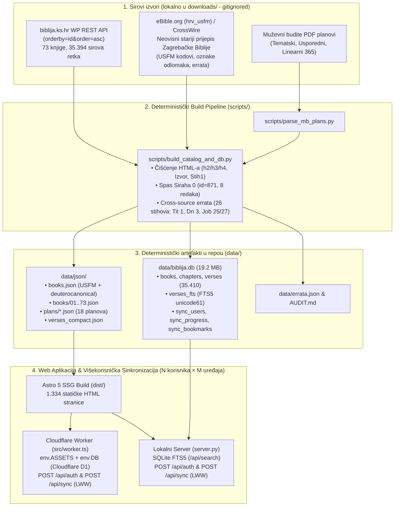
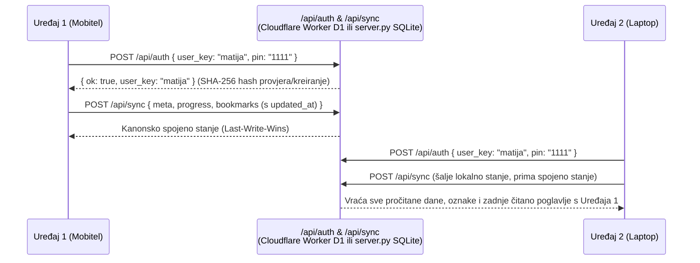
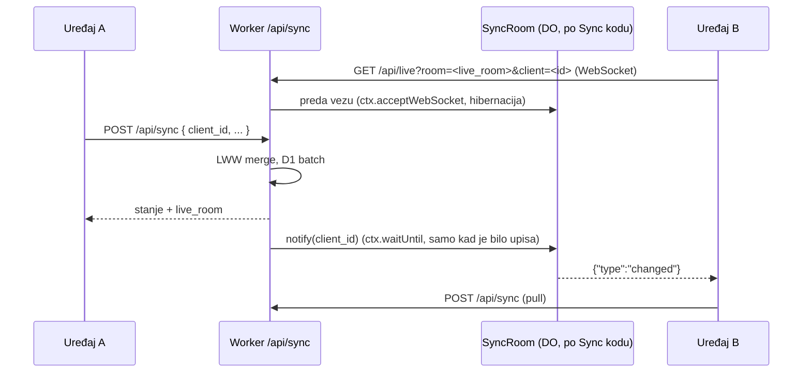

# Arhitektura sustava, unakrsni audit izvora i tehničke zamke (`stepanic/biblija`)

> Vezano: [Mobilne aplikacije — odluka za native SwiftUI + Compose](2026-10-25-mobilne-aplikacije-native.md)

Datum: 2026-10-25  
Vezani dokumenti: [`2026-10-26-premium-ui-ikone.md`](2026-10-26-premium-ui-ikone.md), [`../AUDIT.md`](../AUDIT.md), [`../README.md`](../README.md), [`../data/errata.json`](../data/errata.json), [`../migrations/0001_sync.sql`](../migrations/0001_sync.sql)

---

## 1. Arhitektura i tok podataka

Sustav je izgrađen tako da iz sirovih izvora deterministički generira **statički JSON katalog**, **SQLite FTS5 bazu podataka** i **Astro 5 SSG web aplikaciju (1.334 statičke stranice)** koja radi i lokalno (`server.py` nad `data/biblija.db`) i na rubu mreže (**Cloudflare Workers Static Assets + D1** preko `src/worker.ts`).

---

## 2. Ključne tehničke zamke i rješenja (što ne treba ponovno otkrivati)

### A. Zamka paginacije u WordPress REST API-ju na `biblija.ks.hr`
* **Problem:** Svi zapisi u WordPress bazi Kršćanske sadašnjosti (`bible_book`, `bible_chapter`, `bible_verse`) uvezeni su u istoj sekundi (`2025-05-23T20:28:54`). Standardni poziv na `/wp-json/wp/v2/bible_verse?per_page=100&page=N` sortira po `post_date DESC`. Zbog identičnog `post_date` stupca, MySQL između stranica vraća nedeterministički redoslijed — duplicira jedne i preskače druge retke/poglavlja.
* **Posljedica u samom KS sustavu:** Službeni KS planovi čitanja (`/wp-json/kk/v1/reading-plans`) zbog tog su buga generirani s preskočenim poglavljima u čak **27 knjiga** (npr. preskočeni su *Dj 2*, *Mt 26*, *Mk 14*, *Lk 1*, *Iv 6*).
* **Rješenje:** U [`scripts/fetch_all.py`](../scripts/fetch_all.py) obvezno se koristi `&orderby=id&order=asc`, čime se dobiva 100% deterministički niz bez ijednog preskočenog zapisa.

### B. Skriveni „Proslov prevodiočev" u Knjizi Sirahovoj (`chapter_id = 871`)
* **Problem:** U tablici `bible_verse` postoji 8 redaka (ID `23140..23147`) koji pripadaju uvodnom *Proslovu* Knjige Sirahove (`verse_book_id = 39`, `verse_chapter_id = 871`). Međutim, poziv na `/wp-json/wp/v2/bible_chapter/871` vraća prazan odgovor (`0 bytes`) jer custom serializer puca na `chapter_number = 0`, a web izbornik na `biblija.ks.hr` nudi samo poglavlja `1..51`.
* **Rješenje:** [`scripts/build_catalog_and_db.py`](../scripts/build_catalog_and_db.py) ručno injektira poglavlje `0` (*Proslov*) za `wp_id = 871` i veže svih 8 redaka u [`data/json/books/28_knjiga-sirahova.json`](../data/json/books/28_knjiga-sirahova.json) (dostupno na ruti `/knjiga-sirahova/0/`).

### C. Pogrešna atribucija `eBible.org (hrv_usfm)` i `CrossWire (CroSaric)` izvora
* **Problem:** U međunarodnim biblijskim zbirkama (`eBible.org`, `CrossWire SWORD`, `scrollmapper/bible_databases`) datoteka `hrv_usfm.zip` / `CroSaric` deklarirana je kao *„prijevod Ivana Ev. Šarića (1941./42.)"*. Zbog toga je u ranijem eksperimentalnom repozitoriju `domovinatv/biblija` (sada arhiviranom) taj izvor obrađen kao Šarićev prijevod.
* **Dokaz:** Izravnom stih-po-stih usporedbom s bazom `biblija.ks.hr` dokazano je da `eBible / CroSaric` uopće **nije Šarićev prijevod**, nego starija neovisna digitalizacija **Zagrebačke Biblije (Kršćanska sadašnjost, 1968.)**:
  1. Ime Božje **`Jahve`** pojavljuje se tisućama puta (Šarić koristi isključivo *Gospod* / *Gospodin*).
  2. U 57 od 73 knjige prvih 5 stihova je od riječi do riječi identično s `biblija.ks.hr` (uključujući prijevod Novog zavjeta Bonaventure Dude i Jerka Fućka, npr. *Iv 1,1*: *„U početku bijaše Riječ i Riječ bijaše u Boga i Riječ bijaše Bog"*).
  3. Na kraju `2 Mak 15,39` u `eBible` izvoru zaostao je komentar iz starog scrapea *The Unbound Bible* projekta (`#THE UNBOUND BIBLE (www.unboundbible.org) #name Ukrainian: NT (P.Kulish, 1871)...`), uz brojne odrezane stihove (`Post 47,4`, `Post 47,12`, `Izl 36,37`, `1 Sam 2,22`, `Jr 25,2`).

### D. Rekonstrukcija 26 oštećenih stihova u `biblija.ks.hr` pomoću unakrsne usporedbe (`data/errata.json`)
Budući da je `eBible / CroSaric` neovisni prijepis iste *Zagrebačke Biblije*, unakrsnim diffom otkriveno je i popravljeno **26 oštećenih ili izgubljenih stihova** u službenoj bazi `biblija.ks.hr`:
1. **`Tit 1,1–2`:** Na `biblija.ks.hr` stih `Tit 1,1` slučajno je pregažen završetkom 2. stiha (`"On koji ne laže,"`), pa je cijeli uvodni apostolski pozdrav Poslanice Titu bio izgubljen.
2. **`Tit 1,5` i `Tit 1,10`:** Međunaslovi `Postavljanje starješina` i `Borba protiv krivih učitelja` bili su uneseni bez `<h4>` oznaka izravno u tekst stiha.
3. **`Dn 3,91–100`:** Na `biblija.ks.hr` 3. poglavlje Daniela prekida se na 90. stihu — nedostajalo je svih 10 završnih stihova poglavlja (`Dn 3,91–100`, izlazak Šadraka, Mešaka i Abed Nega iz peći).
4. **`Job 25,1–4` i `Job 27,1–4`:** Na `biblija.ks.hr` stihovi `Job 25,1` i `Job 27,1` bili su prazni (`""`), a `25,2–4` i `27,2–4` su ispali pri prijelomu premještenih govora iz *Jeruzalemske Biblije*.
5. **OCR artefakti:** Uklonjeni zaostali znakovi `?` na početku `Job 19,1`, `Job 29,1` i `Iz 10,1`, te tipfeler `"spremi sena propast"` u `Est 1,1`.

### E. Service Worker strategija (`sw.js`) i `sync-public` zamka u buildu
* Prvotni *cache-first* Service Worker (`biblija365-v1`) sprječavao je prikaz novih UI izmjena na `localhost` bez ručnog brisanja cachea.
* U [`sw.js`](../sw.js) (`biblija365-astro-v4`) uvedena je **network-first s offline fallbackom** strategija te automatsko čišćenje svih starijih cache ključeva pri aktivaciji (bez prisilnog `client.navigate("/")` kako čitatelj ne bi bio prebačen s trenutnog poglavlja).
* **Zamka `npm run sync-public` skripte:** Skripta `sync-public` u [`package.json`](../package.json) (koja se pokreće kroz `predev` i `prebuild`) kopira korijenske datoteke `styles.css`, `manifest.json` i `sw.js` preko istoimenih datoteka u `public/`. Zato se svaka izmjena CSS-a ili Service Workera mora raditi u korijenskom `styles.css` / `sw.js` (ili u oba), inače će `npm run build` pregaziti promjene u `public/styles.css`.

---

## 3. Višekorisnička sinkronizacija (Sync kod + PIN) i brza promjena profila

* **Brza promjena profila na istom uređaju (`biblija_saved_profiles`):** Modal za sinkronizaciju pamti do 8 prijavljenih profila na uređaju i omogućuje prebacivanje jednim klikom (`#syncSavedProfilesSection`), pri čemu se prije sinkronizacije novog profila obvezno čisti lokalno stanje (`resetLocalUserData()`) kako podaci prethodnog korisnika ne bi prešli na drugi račun.

### Realtime obavijesti: Durable Object `SyncRoom` (2026-10-26)

D1 ostaje izvor istine i protokol `/api/sync` se ne mijenja. WebSocket nosi samo signal
„promijenjeno", a uređaj na njega napravi običan pull.

* `live_room` = SHA-256(`biblija365-live:` + pin_hash). Worker ga vraća u odgovoru `/api/sync`,
  pa sobu ne može naći nitko tko ne zna PIN, a soba ionako ne nosi podatke.
* `client_id` je po kartici ili uređaju; soba ga drži kao tag WebSocketa i pošiljatelju ne šalje obavijest.
* Klijent šalje `"ping"` svakih 30 s; odgovara runtime (`setWebSocketAutoResponse`) bez buđenja objekta.
  Veza se drži samo dok je stranica vidljiva (`visibilitychange` → `closeLive()`), uz backoff do 30 s.
* Najviše 16 veza po sobi; najstarije se zatvaraju.
* Obavijest usred synca ne gubi se: `syncWithServer` postavi `syncAgain` i ponovi kad trenutni završi.
* Hibernation API je uvjet za cijenu: s običnim `accept()` plaćalo bi se cijelo vrijeme otvorene veze.
  Procjena s cjenikom od 2026-10-26: ~600 DO zahtjeva po aktivnom korisniku mjesečno, ~15 $/mj. za
  100.000 i ~180 $/mj. za 1.000.000 korisnika; Free plan podnosi ~5.000 aktivnih dnevno.
* Izmjereno u produkciji: drugi uređaj → web 113 ms, web → drugi uređaj 590 ms (od toga 350 ms debounce).
* `server.py` (lokalni razvoj) nema `/api/live`; klijent tada jednostavno ostaje na pullu.
* Ugovorni test podmeće `cloudflare:workers` preko `registerHooks` jer Node taj modul nema.
* Mobilni klijenti (2026-10-26, buildano, na uređajima još neisprobano): Android `data/LiveConnection.kt`
  (OkHttp 4.12, `pingInterval` 30 s, veza dok je aktivnost STARTED), iOS `App/LiveConnection.swift`
  (`URLSessionWebSocketTask`, veza dok je `scenePhase == .active`). Oba šalju `client_id` u `/api/sync`,
  pamte `live_room` i nakon ponovnog spajanja naprave jedan sync jer je obavijest možda propuštena.

---

## 4. UI/UX arhitektura čitača i navigacije (dovršeno 2026-10-25)

* **Dva načina prikaza teksta (`data-reading-mode="paragraphs" | "verses"`):**
  * **Knjiški prikaz (`paragraphs`):** Koristi `p: true` oznake iz JSON kataloga za renderiranje `` odlomaka kao u tiskanom izdanju *Zagrebačke Biblije*, uz očuvane poetske retke (`poetic-block`) i međunaslove (`h2`/`h3`/`h4`).
  * **Studijski prikaz (`verses`):** Svaki redak počinje u novom retku radi lakšeg proučavanja.
* **Mobilna i desktop navigacija:**
  * Na mobilnim ekranima (`<= 960px`) popis od 73 knjige pretvoren je u kliznu ladicu (`#bookSidebarDrawer`) koja se otvara na gumb `📚 Promijeni knjigu ▾` (umjesto statičke kartice iznad teksta poglavlja), uz fiksnu donju navigacijsku traku (`mobile-bottom-nav`).
  * Dodan je filtar **Deuterokanonske knjige (`DK (7)`)**, kontekstualne kratice prethodnog/sljedećeg poglavlja (`prevLabel` / `nextLabel`) i tipkovnička navigacija strelicama `←` / `→`.

---

## 5. Otvorene stavke za sljedeću sesiju

1. ~~**Produkcijski Cloudflare + D1 Deploy**~~ — napravljeno 2026-10-26: Worker `biblija-365` na
   <https://biblija.domovina.ai> (Cloudflare račun D.O.M., `account_id` u [`wrangler.jsonc`](../wrangler.jsonc)),
   D1 `biblija-365-db` (EEUR), migracije 0001 i 0002 primijenjene. Novi deploy: `npm run deploy`;
   nove migracije: `npx wrangler d1 migrations apply biblija-365-db --remote`.
