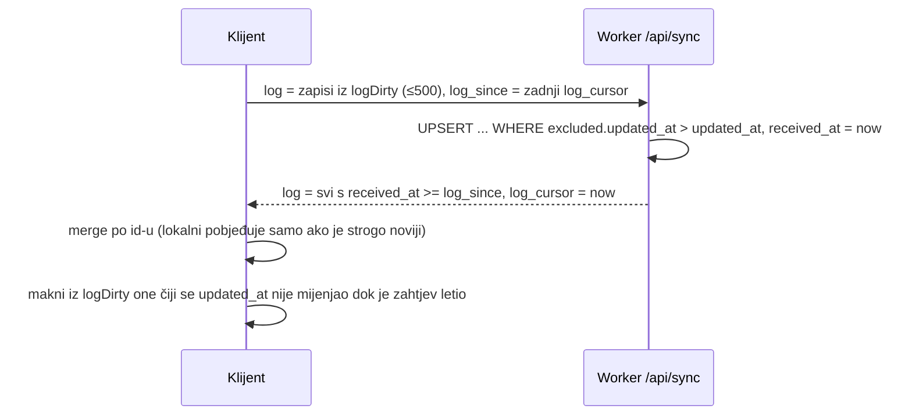

# Dnevnik čitanja i linearni kursor (2026-10-26)

Commit `cab857a`, deployano na https://biblija.domovina.ai (D1 migracija `0003_reading_log.sql` primijenjena `--remote`).

Korisnički zahtjev: „da se pamti sva povijest točno gdje i koji trenutak" (dnevnik čitanja) i da se ad hoc skok
ne izgubi mjesto linearnog čitanja; plus mogućnost da linearno čitanje počne bilo gdje (netko je čitao izvan
aplikacije ili zaboravio stari login), bez stotinu klikova „sljedeće".

Prije ovoga postojao je samo `meta.last_url`, koji je svaki otvoreni chapter pregazio.

## Model

| Pojam | Gdje | Merge |
|---|---|---|
| **Linearni kursor** `{url, label, verse, updated_at}` | D1 `sync_linear`, polje `linear` u `/api/sync` | LWW po `updated_at` |
| **Dnevnik** `{id, url, label, verse, started_at, ended_at, linear, device, updated_at}` | D1 `sync_reading_log`, polja `log` / `log_since` / `log_cursor` | LWW po `id` |
| `meta.last_url` | nepromijenjeno | zadnje otvoreno, i dalje postoji |

Kursor je zaseban stupac/tablica, a ne dio `meta`, jer je `meta` jedna LWW jedinica: svaki skok (`last_url`)
s drugog uređaja pregazio bi kursor.

Pravila (ista na webu, `UserData.beginVisit/updateVisit` u Swiftu i Kotlinu):

- Kursor se pomiče samo kad je otvoreno poglavlje **isto** ili **sljedeće** (prethodnik otvorenog == kursor),
  ili kad kursora nema. Sve ostalo je „skok" → traka *Vrati se / Nastavi redom odavde*.
- Redak kursora prati vrh ekrana, ali **samo kad se redak stvarno promijeni**. Otkucaj (30 s) otvorene kartice
  na drugom uređaju inače bi novijim `updated_at` pregazio kursor koji je u međuvremenu otišao dalje.
- „Ovdje sam stao" (`linearPin`): kursor ne prati skrolanje dok se redak na vrhu ne pomakne s onog zatečenog pri
  kliku. Bez toga je prvi pomak rasporeda (osvježavanje nakon synca) zapisao redak na vrhu (13) umjesto
  odabranog (16) — uhvaćeno e2e testom.
- Isto poglavlje s istog uređaja unutar 30 min nastavlja postojeći zapis (reload, natrag).
- Traka „izvan reda" se ne prikazuje dok je aktivan dan Biblije 365 (plan namjerno skače).
- Migracija starih klijenata: ako nema kursora, `last_url` postaje kursor s `updated_at = 1970-01-01T00:00:00.001Z`,
  da ne pregazi kursor koji već postoji na serveru.

## Inkrementalni sync dnevnika

- `received_at` je serversko vrijeme, pa satovi klijenata ne utječu na to što se povlači.
- `>=` vraća i vlastite upravo poslane zapise jednom više; to je namjerno (bezopasno, a ne gubi istovremene upise).
- **Zamka na mobitelu:** odgovor sadrži samo *delta* dnevnika, pa stara usporedba `merged != result.data`
  („ima li novijeg lokalnog") bila bi uvijek istinita → beskonačan resync. Sad se uspoređuju samo meta/progress/
  bookmarks/linear, a dirty zapisi samo ako je server nešto potvrdio. Ako server ne vraća `log_cursor` (stari
  `server.py`), dnevnik se ne potvrđuje i ne izaziva resync.
- Web šalje sync s `keepalive: true` pri `pagehide`/skrivanju kartice samo ako je tijelo < 60 KB (limit preglednika
  je 64 KB, a payload nosi i sve oznake).

## Pozicija retka

- Web: `topVerse()` = zadnji redak čiji je vrh iznad crte `6rem + 6px`; `.verse-item { scroll-margin-top: 6rem }`.
  Nastavak koristi `#od-N` (redak na vrh, `block: "start"`), a ne `#v-N` (sredina, za pretragu/oznake). S `#v-N`
  bi se zapamćeni redak svakim nastavkom pomaknuo unatrag.
- iOS: `.scrollPosition(id:anchor: .top)` + `.scrollTargetLayout()` daje id bloka na vrhu → redak iz id-a
  (`p12`, `v12`, `h12-0`, `r12-0`).
- Android: `snapshotFlow { firstVisibleItemIndex }`, ispred blokova su 3 stavke (`LEADING_ITEMS`: traka kursora,
  traka plana, zaglavlje).
- U knjiškom prikazu na mobitelu preciznost je **početak odlomka**, ne redak (blok = odlomak). Web je precizan po retku.

## UI

- Web: `/dnevnik/` (nova kartica u navigaciji, mobilna traka sad ima 5 stavki), traka u `ChapterView.astro`,
  „Ovdje sam stao" u popoveru retka, „Nastavi gdje si stao" na `/` koristi kursor + „Zadnje otvoreno".
- iOS: `ReadingLogView` (ikona u Oznakama, jer TabView već ima 5 kartica), `LinearReturnBanner`, gumb u `VerseActionSheet`.
- Android: `ReadingLogScreen` (ikona u Oznakama), `LinearReturnBanner`, gumb u `VerseSheet`.
- Uređaj u dnevniku: web „Web · Mac/iPhone/…", iOS „iPhone"/„iPad", Android `Build.MODEL`.

## Kursor i plan „Biblija 365 — Kanonski redom"

Kad je aktivni plan `biblija-365-kanonski` (jedini koji ide redom kao kursor; ostali miješaju knjige),
pomak kursora nudi označavanje dana pročitanima: web toast `#planCatchUpToast`, iOS `PlanCatchUpBanner`
u `RootView`, Android `PlanCatchUpBanner` u `BiblijaApp`. Logika: `offerPlanCatchUp` (web),
`PlanCatchUp.daysToOffer` (BiblijaKit i `:core`, s testovima na pravom planu).

- Uvijek uz potvrdu („Označi" / „Ne"), nikad tiho; već označeni dani se ne diraju, ništa se ne poništava.
- Dan je gotov kad mu je kraj (zadnje poglavlje zadnjeg čitanja) **prije** kursora; usporedba
  `book_order * 1000 + poglavlje`, Proslov = 0. Dan koji sadrži kursorovo poglavlje ostaje neoznačen
  (kursor na 2 Kr 6 → dani 1–102, dan 103 „2 Kr 6–8" ne).
- Ručno postavljanje (/dnevnik/ „Postavi", „Ovdje sam stao", „Nastavi redom odavde") nudi sve neoznačene
  dane prije kursora. Linearni korak nudi samo dane s krajem u `[stari kursor, novi kursor)`, pa odbijeni
  dan ne iskače ponovno pri svakom poglavlju.
- Kursor koji stigne syncom s drugog uređaja ne nudi ništa (ponudio ga je uređaj na kojem se čitalo).
- Zadnji dan plana (završava na Otk 22) linearni korak nikad ne ponudi jer kursor ne može dalje.

## Otvoreno

- iOS i Android **nisu pokrenuti na uređaju** s ovom značajkom (samo build + unit testovi). Provjeriti:
  traku „izvan reda", da `scrollPosition` ne smeta `proxy.scrollTo` pri skoku na redak, i sync dnevnika web ↔ mobitel.
- `server.py` dobio je iste endpointe, ali nije pokretan.
- Nema brisanja pojedinačnih zapisa dnevnika (namjerno: dnevnik je trajni zapis). Brisanje računa briše sve.
- Web drži cijeli dnevnik u `localStorage` (~250 B po zapisu); ako ikad zatreba, ograničiti lokalnu kopiju.

Vezani dokumenti: [arhitektura i sync](2026-10-25-arhitektura-i-audit-izvora.md),
[mobilne aplikacije](2026-10-25-mobilne-aplikacije-native.md).
