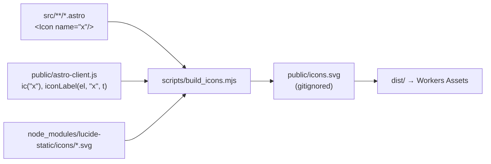

# Premium UI web aplikacije: Lucide ikone umjesto emojija (2026-10-26)

Vezani dokumenti: [`2026-10-25-arhitektura-i-audit-izvora.md`](2026-10-25-arhitektura-i-audit-izvora.md) (poglavlje 4, UI arhitektura čitača)

Commit `450c77c`, deploy na biblija.domovina.ai (version `b9e79e44`). Dirano samo web sučelje; iOS/Android nisu dirani.

## Odluka: SVG sprite, ne icon font

Korisnik je predložio Material Icons, Lucide ili Font Awesome s treeshakeanim fontom. Izabran je **Lucide (`lucide-static`, ISC) kao SVG sprite**:

| Opcija | Zašto odbačena / izabrana |
|---|---|
| Icon font (Font Awesome, Material Symbols) | FOIT/ligature flash dok se font učitava, mutnije na nepravilnim veličinama, subset fonta svejedno desetke KB; Material Symbols subset preko Google Fonts `icon_names=` je vanjska ovisnost, loše za offline PWA |
| Inline SVG u svakom HTML-u | 1.334 stranice × ~15 ikona; ne kešira se između stranica |
| **Sprite `/icons.svg` + `<use href>`** | jedan keširani request, 42 ikone = 7,3 KB, `currentColor` radi u sve tri teme |

Lucide je izabran zbog stila (tanka linija, 24×24, stroke 2), koji odgovara serifnom čitaču bolje od Material ispune.

## Kako radi treeshake

- Pokreće se u `npm run sync-public` (dakle `predev` i `prebuild`, pa i `deploy`).
- `public/icons.svg` je u `.gitignore`; generira se uvijek iznova.
- Nepoznato ime ikone ruši build (`build_icons: nepoznate Lucide ikone: …`).
- U JS-u se za korisnički tekst koristi `iconLabel()`, koji tekst stavlja kroz `textContent`. Ne koristi `innerHTML` s `user_key` ni bilješkama.

## Zamke

- **Regex hvata svaki string literal unutar `ic(...)`.** `ic(el.type === "password" ? "eye" : "eye-off")` je srušio build jer je "password" protumačen kao ikona. Usporedbu izvući u varijablu prije poziva (`const pinVisible = …; ic(pinVisible ? "eye-off" : "eye")`).
- **`styles.css` ima isti selektor na top-levelu i u media queryju.** Pri prepisivanju pravila skriptom zamijenio sam top-level `.mobile-reader-bar { display:none }` i `.sidebar-drawer-header { display:none }`, pa su se mobilna traka i zaglavlje drawera pojavili na desktopu. Uvijek provjeriti koja je pojava pravila (top-level ili `@media`).
- Uređuje se **korijenski `styles.css`**; `public/styles.css` je kopija iz `sync-public`.
- `<option>`/`<optgroup>` ne mogu sadržavati SVG, pa su ★ i • iz izbornika planova samo uklonjeni.
- SW cache podignut na `biblija365-astro-v5` (precache `icons.svg`, `favicon.svg`). Kod sljedeće promjene statičkih asseta opet podignuti verziju.

## Dizajnerski sustav (tokeni u `styles.css` `:root`)

- `--accent-gradient`, `--on-accent` (u tamnoj temi tamni tekst na zlatnom), `--bg-sunken` za inpute, `--text-subtle`, `--ring` za fokus, `--shadow-xs/--shadow/--shadow-lg` slojevite.
- Radijusi 8/12/18/22 px; naslovi stranica, knjige i modala u `--font-display` (Iowan/Palatino), UI ostaje sistemski sans.
- Mobilno (<560 px): zaglavlje samo logo + naslov, sync i tipografija kao ikone; donja traka ima Material 3 pill indikator.
- Svjesne promjene teksta: tab „Oznake & Audit" → „Oznake"; engine pill vidljiv tek ≥1240 px.

## Otvoreno

- Sync modal u prijavljenom stanju (statistike s ikonama, spremljeni profili, spinner na „Sinkroniziram…") nije vizualno provjeren s pravim računom.
- Pretraga s `?q=` nije provjerena s rezultatima (lokalni statički server nema `/api`).
- Mobilne aplikacije još imaju vlastiti izgled; ako se želi isti vizualni jezik, Lucide postoji i za Compose/SwiftUI (ili SF Symbols / Material Symbols kao nativni ekvivalent).
