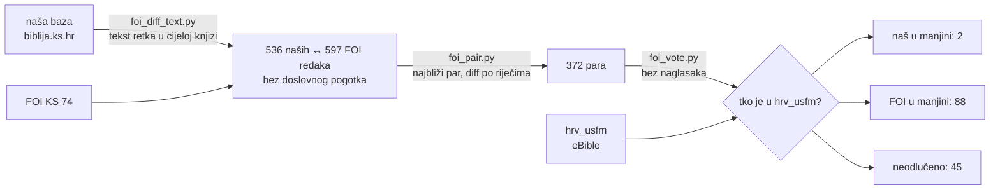

# FOI „Biblijski prijevodi" — dohvat 15 prijevoda i trosmjerna usporedba KS-a

`https://library.foi.hr/biblija/index.php?type=biblija` (FOI Varaždin, u podnožju
„Copyrights by Point d.o.o."). Dohvaćeno 2026-10-27/28, bez LLM poziva.

## Ukratko

- Svih 15 prijevoda je u lokalnom cacheu `downloads/cache/foi/` (gitignored, 137 MB).
- Među njima je **pravi Šarić** (ID 75, 73 knjige), kojeg dosad nismo imali.
  `eBible/CroSaric` je zapravo Zagrebačka Biblija 1968. (vidi
  [arhitektura i audit izvora](2026-10-25-arhitektura-i-audit-izvora.md)).
- Trosmjerna usporedba (naša baza ↔ FOI KS ↔ `hrv_usfm`) našla je 7 OCR grešaka u
  `biblija.ks.hr`; dodane su u `ocr_fixes` u `scripts/build_catalog_and_db.py`.
  Errata ih sada ima 33.

## Kako stranica radi

Nema API-ja, ali sve je dostupno običnim GET-om i bez sesije:

```
index.php?type=biblija&bid=<bid>&ch=<NNNN>&tra1=<id>&tra2=999&tra3=999
```

- `bid` su FOI kodovi knjiga: `001`…`066`, a deuterokanonske imaju sufiks (`016a`
  Tob, `016b` Jdt, `017a/b` 1–2 Mak, `022a` Mudr, `022b` Sir, `025a` Bar).
  Kod 73-knjižnih prijevoda poredak se **1:1 poklapa** s našim `books.json`
  `order`, pa mapiranje ide po poziciji.
- Popis knjiga je u `<SELECT id="bid">`, a popis poglavlja su linkovi
  `type=biblija&bid=X&ch=NNNN&tid=&zid=&tra1=T&` na stranici 1. poglavlja.
- `tra2`/`tra3` daju do tri prijevoda poravnata po stihu u jednom zahtjevu.
  Nismo to koristili jer nije jasno što se događa kad prijevodi imaju različit
  broj stihova.
- `type=bibdet&...&rch=NNNN` (`rch` s četiri znamenke) je stranica jednog
  stiha: svi prijevodi i interlinear (hebrejski za SZ, grčki za NZ). Interlinear
  je **Berean Interlinear** (BSB): riječ, transliteracija, morfologija, Strong i
  engleska glosa, a deuterokanonske knjige ga nemaju. Isti podaci su CC0 u
  `https://bereanbible.com/bsb_tables.xlsx` (55 MB), pa ih
  `scripts/fetch_bsb_interlinear.py` uzima odande umjesto ~31.000 FOI zahtjeva.
  Mt 1,1 i Post 1,1 provjereni su riječ po riječ protiv FOI-ja. Izlaz je
  `downloads/bsb/interlinear/` (gitignored, 31 MB) i ima englesku numeraciju.
  Strongov rječnik FOI puni AJAX-om (`inc/bibstrong_view.php?la=Greek&q=00976`)
  i on nije dohvaćen.
- Međunaslovi nisu označeni posebno, nego su samo još jedan `<br>` red u tekstu
  stiha. Parser zato sprema `lines`.

Odgovor traje oko 0,45 s. Uz 2 radnika i pauzu od 0,4 s cijeli dohvat (~12.000
stranica) trajao je **5.130 s**.

## Prijevodi

| ID | Prijevod | Knjiga | Redaka |
|---|---|---|---|
| 74 | Biblija KS (Duda–Fućak) | 73 | 35.361 |
| 75 | Biblija (Šarić) | 73 | 35.272 |
| 76 | Biblija (Katančić, 1831.) | 67 | 30.989 |
| 14 / 11 / 32 / 34 / 37 / 35 | NZ: Duda–Fućak / Rupčić / Šarić / Katančić / Raspudić / Gusić (kajkavski) | 27 | 7.945–7.957 |
| 72 | Vulgata | 78 | 37.231 |
| 73 | BSB | 66 | 31.102 |
| 5 | BHS | 39 | 23.213 |
| 7 / 8 / 71 | LXX / GNT / LXX+GNT | 53 / 28 / 81 | 38.428 / 7.967 / 46.372 |

Šarić je provjeren po sadržaju: „Gospod je moj pastir" (Ps 23), „U vrijeme kad
Gospodin Bog stvori zemlju i nebo" (Post 2,4), bez *Jahve*.

### Prava

Ovo je samo za lokalnu provjeru, ne za objavu. Šarić je umro 1960., pa je po
pravilu 70 godina p. m. a. slobodan tek od **1. 1. 2031.** Duda–Fućak, Rupčić,
Raspudić, BHS, LXX (Rahlfs) i GNT su zaštićeni. Slobodni su Katančić, Vulgata
i BSB (CC0), no Vulgata i BSB postoje i u čišćim izvorima.

## FOI-jev KS je lošiji od našeg

Ne koristi ga kao primarni izvor:

- **fale cijela poglavlja:** Post 5 (retci su ugurani u Post 4,27–32), te Ps 113,
  115 i 147 (0 stihova);
- Obadija je spremljen kao poglavlje 9, a Psalmi su numerirani bez naslova kao
  1. retka;
- naglasci su pokvareni (`Tà` → `T?`, `lûk` → `l?k`).

Zato usporedba po ključu (knjiga, poglavlje, redak) daje lažne razlike: 923 retka
„samo kod nas" i 813 „samo na FOI-ju".

## Metoda usporedbe



Brojevi u dijagramu su **nakon** ispravaka. Prije ispravaka bilo je 543 retka i
9 mjesta gdje je naša baza u manjini.

Pokretanje (izlaz ide u trenutni direktorij, pa koristi scratch direktorij):

```bash
python3 scripts/fetch_foi.py [ID ...]   # nastavlja gdje je stao
python3 scripts/parse_foi.py [ID ...]   # downloads/cache/foi/<ID>.json
python3 scripts/foi_diff_text.py 74
python3 scripts/foi_pair.py diff_74.json pairs_74.json
python3 scripts/foi_vote.py pairs_74.json vote_74.json
```

`foi_vote.py` čita `hrv_usfm` iz arhiviranog klona
`/Users/ms/git/domovinatv/biblija/.cache/saric/usfm/`.

## Ispravljeno (FOI i hrv_usfm se slažu)

Post 50,14 „Egi pat"; Lev 4,12 „mjestoizvan"; Rut 4,5 „iRutu"; Ezr 1,1 „Ki- ra";
Ps 17,10 „zatvarajui"; Ps 113,3 „zalaskahvaljeno"; Ps 119,80 „pravilimada".

Pretraga obrasca `\w+- [a-z]` po cijeloj bazi našla je samo Ezr 1,1.

## Namjerno ostavljeno

Oba druga izvora se slažu, ali drugi izvori su vjerojatno u krivu:

- **Izr 28,7** — naše „izjelicama" vs njihovo „izbjeglicama". Hebr. *zolelim* znači
  proždrljivci, pa je naše smisleno ispravno. Vjerojatno je riječ o zajedničkoj
  pogrešci u starijim digitalizacijama.
- **Mt 27,12** — naše „optuživali" vs „optuživale". „Starješine … optuživale" može
  biti stara sročnost s bližom imenicom.

Za oba treba pogledati tiskano izdanje.

## Katančić u čitaču

`scripts/build_katancic.py` piše `data/json/katancic/` (67 knjiga, 3,4 MB), a
čitač ima gumb prijevoda: KS, KS + Katančić (ispod svakog retka) ili samo
Katančić. Oznake, plan i dnevnik ostaju na retcima KS-a.

FOI je Katančićeve psalme prenumerirao na hebrejske brojeve samo do 113. Ostale
Vulgatine razlike (Izl 7/8, Lev 5/6, Br 16/17, Neh 3/4, Ez 20/21, Zah 1/2, Jl,
Mal, Ps 114–150, Sir proslov) preslikava `remap()`. Provjereno po sadržaju. Tob,
Jdt, Est i Sir su u Vulgati drugi tekst, pa čitač za njih to i napiše. 1–2 Sam,
1–2 Kr i 1–2 Ljet FOI nema.

## Otvoreno

- 45 neodlučenih mjesta (`vote_74.json`): uglavnom drukčije lomljenje stihova.
  Zanimljiva su Ezr 6,22, Lk 14,28 (FOI dodaje „se"), Dj 20,37 („obisnuše se" vs
  „padoše") i Jak 1,1.
- Šarićev NZ (32) usporediti s NZ-om Šarićeve Biblije (75).
- Šarić kao drugi prijevod u aplikaciji tek uz dozvolu nositelja prava ili 2031.
- Katančićev prijevod (1831.) je slobodan, ali tekst je FOI-jeva digitalizacija
  („Copyrights by Point d.o.o."). Preuzimanje cijele knjige može dirati
  *sui generis* pravo na bazu podataka (ZAPSP). Prije deploya i commita
  `data/json/katancic/` treba odluka ili dozvola. Mobilne aplikacije Katančića
  još nemaju.
- Mobilna baza (`export_mobile_db.py`) i deploy s novih 7 ispravaka nisu pokrenuti.
