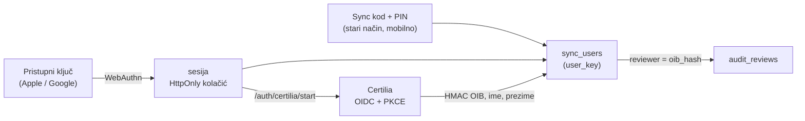

# Pristupni ključ za sinkronizaciju, Certilia za presude (2026-11-04)

## Odluka

- **Sinkronizacija:** glavni način je pristupni ključ (passkey). Ključ se sprema u Apple Passwords
  ili Google Password Manager i sam dolazi na korisnikove uređaje, pa nema ničega što bi trebalo
  zapamtiti. Profil nastaje upisom ključa: dovoljno je ime profila.
- **Sync kod + PIN je stari način.** Na webu je pod „Stari način” u modalu, a postojećem profilu
  nudi se „Dodaj pristupni ključ ovom profilu”. Mobilne aplikacije (iOS, Android) i dalje rade
  samo sa Sync kodom i PIN-om, dok ne dobiju native passkey. PIN profila kojem je dodan ključ
  i dalje vrijedi, upravo zbog mobilnih aplikacija.
- **Presude na /provjera/:** pregled nalaza traži profil s ključem. Slanje presude traži i
  Login with Certilia, da se zna ime i prezime osobe. Certilia se veže uz profil jednom
  (izbor 2026-11-04: „uz profil, jednom”, ne svježa Certilia po sesiji).

## Kako radi



| Dio | Gdje |
|---|---|
| Passkey, sesija, Certilia | `src/auth.ts` |
| `/api/sync` i `/api/account/delete` bez PIN-a (iz sesije) | `src/worker.ts` |
| Presude po osobi, ime u CSV-u | `src/provjera.ts` |
| Klijent: modal, WebAuthn, `window.biblijaPasskey` | `public/astro-client.js`, `src/layouts/BaseLayout.astro` |
| /provjera/: korak 1 ključ, korak 2 Certilia | `src/pages/provjera/index.astro` |
| Tablice | `migrations/0005_passkey_certilia.sql` |

Preneseno iz e-satnice (`~/git/most/e-satnica/e-satnica`: `src/lib/passkey.ts`,
`src/lib/oidc/klijent.ts`, `src/lib/certilia/oidc.ts`), koja je passkey preuzela iz
`pay.domovina.ai`. Razlika: u e-satnici je Certilia korijen identiteta, a ključ samo brži ulaz.
Ovdje je ključ korijen profila, jer je profil samo čitanje i bilješke te osobe.

### Pravila

| Pravilo | Zašto |
|---|---|
| Profil s ključem ima `pin_hash = "!" + nasumično` | PIN se na takav profil ne može prijaviti (hash nikad ne počinje s `!`), a vrijednost služi kao tajna za ime realtime sobe |
| `/api/sync` bez `pin` čita profil iz kolačića; `user_key` u tijelu mora biti isti | tuđi profil se ne može sinkronizirati podmetanjem `user_key` |
| Drugi ključ istom profilu samo unutar 10 min od prijave ključem | ukradeni kolačić ne postaje trajni ključ |
| Postojeći PIN profil dobiva ključ uz točan PIN | prijelaz sa starog načina; PIN se nakon toga briše iz preglednika |
| Jedini ključ profila bez PIN-a ne može se obrisati | inače se na profil više nitko ne može prijaviti |
| `userVerification: required`, `residentKey: required`, izazov jednokratan 5 min | kao u pay/e-satnici |
| rpID = host zahtjeva | ključ s localhosta ne otvara produkciju |
| OIB samo kao `HMAC(AUTH_SECRET, "oib:" + OIB)`; jedan OIB, jedan profil | ako se ista osoba poveže s drugim profilom, veza prelazi na njega |
| Presude su jedinstvene po `(finding_id, reviewer)`, `reviewer` = OIB otisak | ista osoba s dva profila ne broji se kao dvije neovisne presude |
| Callback Certilije mora stići u istu sesiju koja je tok pokrenula | inače `druga_sesija` |
| POST sa sesijom mora imati isti `Origin` (uz `SameSite=Lax`) | CSRF |
| Revizija svih prijava u `auth_log`, imena claimova bez vrijednosti | kao `prijave` u e-satnici |

Sesija je potpisani kolačić `biblija_sesija` (HMAC, `AUTH_SECRET`), 400 dana. Obrisan profil
poništava sesiju, a odjava briše kolačić.

## Podešavanje

```bash
# jednom: tajna za sesiju i OIB otisak (NE rotirati: OIB otisci i ime realtime sobe ovise o njoj)
openssl rand -base64 48 | npx wrangler secret put AUTH_SECRET
# nakon registracije Service Providera na developer.certilia.com
npx wrangler secret put CERTILIA_CLIENT_ID
npx wrangler secret put CERTILIA_CLIENT_SECRET
curl -s https://biblija.domovina.ai/auth/certilia/status   # clientId/clientSecret/authSecret: true
```

Certilia Service Provider (developer.certilia.com → Create Service Provider (IDP)):

| Polje | Vrijednost |
|---|---|
| Service provider name | `Biblija` (vidi se na ekranu za pristanak) |
| Protocol / Grant type | `OIDC/OAuth2` / `authorization_code` |
| Callback URL | `https://biblija.domovina.ai/auth/certilia/callback` (bez završnog `/`) |
| User data / Mandatory | samo `pin`, `firstname`, `lastname` |

Gumb „Login with Certilia” na /provjera/ radi čim su oba Certilia secreta postavljena. Do tada
piše „Certilia još nije podešena”.

## Provjereno (2026-11-04, lokalno)

Chrome s virtualnim autentifikatorom (CDP `WebAuthn`) i lažni Certilia IdP (discovery na
Certilijinoj putanji, PKCE S256, RS256, OIB u `sub`):

- novi profil ključem, sync bez PIN-a, odbijen tuđi `user_key`, odbijen PIN na profilu s ključem;
- odjava, pa prijava ključem; jedini ključ se ne briše;
- stari profil (Sync kod + PIN), pa „Dodaj pristupni ključ”: PIN nestaje iz preglednika, a na
  poslužitelju i dalje vrijedi (mobilno);
- /provjera/: presuda bez Certilije daje 403, Certilia povezuje ime, presuda prolazi, lažni
  `state` je odbijen, ista osoba s drugog profila ima jednu presudu, ime je u CSV-u;
- `npm run test:contract` (19/19, sad s migracijama 0004 i 0005).

Na pravom uređaju (iPhone, Android) i s pravom Certilijom još nije isprobano.

## Zamke

- **`wrangler dev` mijenja host u produkcijski** (`custom_domain` ruta): `request.url` je
  `https://biblija.domovina.ai/…`, pa je rpID krivi i WebAuthn javi „relying party ID is not a
  registrable domain suffix”. Lokalno pokretati s
  `npx wrangler dev --port 8787 --local-upstream localhost:8787`.
- **`not_found_handling: 404-page` guta navigaciju:** zahtjev sa `Sec-Fetch-Mode: navigate` na
  putanju koje nema u `dist` (npr. `/auth/certilia/start`) dobije 404 stranicu i ne dođe do
  Workera. Zato `assets.run_worker_first` za `/auth/*`, `/api/*` i `/.well-known/*`.
- **`loadStats()` na /provjera/ prepisuje `#pvStats`:** poruke idu u `#pvNotice`.
- **Mobilne aplikacije:** `/.well-known/apple-app-site-association` već oglašava
  `webcredentials` za `6SCK58757K.hr.stepanic.biblija365`, pa će ključevi s weba raditi i u iOS
  aplikaciji kad dobije Associated Domains i `ASAuthorizationPlatformPublicKeyCredentialProvider`.
  Androidu treba `assetlinks.json` sa SHA-256 potpisnog certifikata (Play App Signing), koji
  još nemamo.
- `node --test` uvozi `src/worker.ts` izravno, pa lokalni uvozi moraju imati nastavak `.ts`.

## Vezani dokumenti

- `docs/2026-11-04-automatska-provjera-ks-teksta.md`: /provjera/ i nalazi
- e-satnica `docs/certilia.md`, `docs/passkey.md`: izvor prenesenog koda i izmjerene zamke Certilije
