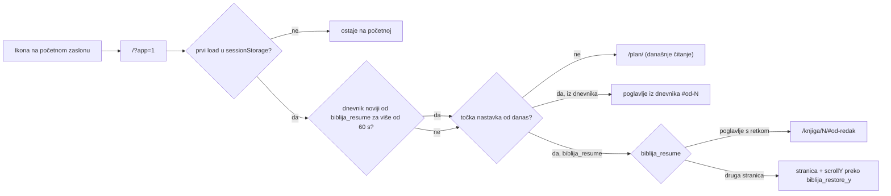

# PWA na iOS početnom zaslonu i nastavak čitanja

Stanje 2026-11-04, commit `4cfa2fc`, u produkciji na biblija.domovina.ai.

## Zašto treba vlastita točka nastavka

iOS ne vraća stanje ubijene web aplikacije: pokretanje s ikone uvijek otvara
`start_url` iz manifesta. Dok je aplikacija samo u pozadini, stanje ostaje i
ništa se ne događa. Zato `astro-client.js` vodi lokalnu točku nastavka.

- `biblija_resume` (localStorage, samo ovaj uređaj): `{href, verse, y, at}`.
  Sprema se 400 ms nakon skrolanja, na `visibilitychange: hidden` i `pagehide`,
  te 1,2 s nakon učitavanja. `/provjera/` se ne sprema.
- Okidač je `?app=1` ili standalone način (`navigator.standalone` /
  `display-mode: standalone`), i to samo na prvom loadu sesije
  (`sessionStorage.biblija_launched`). Klik na početnu unutar aplikacije zato
  ne preusmjerava. Stare instalacije s `start_url: ./index.html` hvata
  standalone provjera.
- Od 2026-11-08 prvo pokretanje u danu (točka nastavka nije od današnjeg
  lokalnog datuma, ili je nema) vodi na `/plan/`, gdje je na vrhu današnje
  čitanje po kalendaru. Ponovno pokretanje istog dana nastavlja kao prije.
  Plan se pri nastavku uvijek otvara na vrhu (`y = 0`). Vidi
  `docs/2026-11-08-plan-po-kalendaru.md`.
- Pretraga drži upit u URL-u (`/pretraga/?q=`), pa se i ona vraća.
- Service worker v7: offline navigacija pada na `caches.match(..., { ignoreSearch: true })`,
  jer `/?app=1` i `?q=` nisu u cacheu pod tim ključem.

## Zamke

- **Standalone PWA na iOS-u ima zaseban spremnik kolačića i localStorage od
  Safarija.** Prijava ključem iz Safarija ne vrijedi u aplikaciji. Treba se
  jednom prijaviti unutar aplikacije. Nakon toga sync povuče kursor i dnevnik.
- Ikonu koja je dodana prije ovog commita treba maknuti i dodati ponovno, da
  iOS uzme novi manifest i `apple-touch-icon.png`.
- iOS ne koristi SVG ikone. PNG-ovi (180/192/512) su izrezani iz
  `ios/.../AppIcon-1024.png` (`scripts/gen_app_icon.py`) s `magick -resize`.
  Promijeni li se ikona, treba ih ponovno izrezati.
- Status bar je `default`, ne `black-translucent`, da topbar ne treba
  `safe-area-inset-top`.

## Otvoreno

- Na pravom iPhoneu još nije isprobano: prijava ključem iz standalone
  aplikacije te nastavak nakon gašenja povlačenjem gore. Isprobano je samo u
  Braveu na desktopu, simuliranim `/?app=1`.
- Otvoreni prozori (modal za sinkronizaciju, popover retka) se ne vraćaju,
  vraća se samo stranica i mjesto na njoj.

Vezani dokumenti: [dnevnik čitanja i linearni kursor](2026-10-26-dnevnik-citanja-i-linearni-kursor.md),
[passkey i Certilia](2026-11-04-passkey-i-certilia.md).
