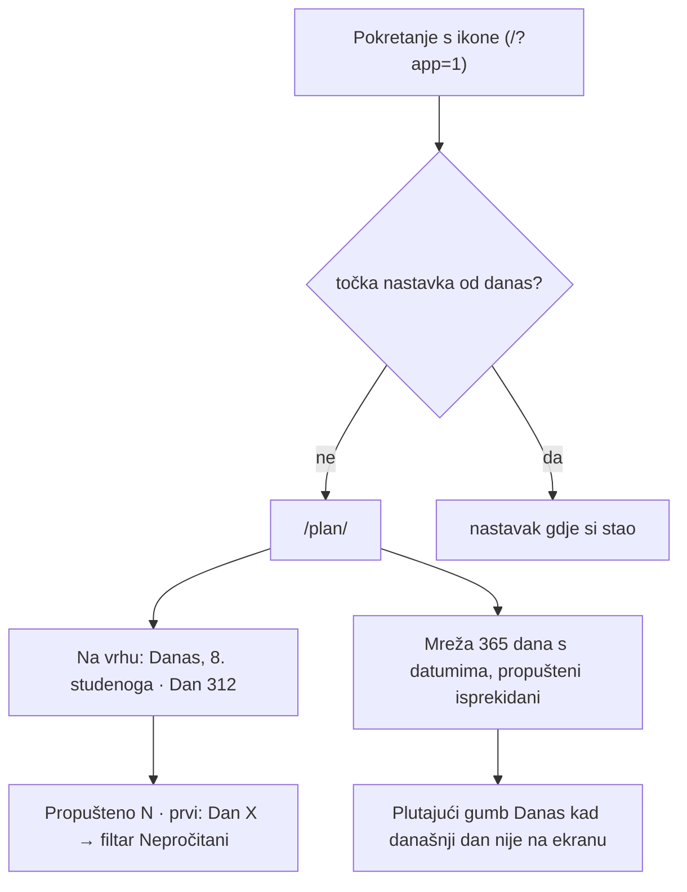

# Plan čitanja po kalendaru: „danas” je datum, ne napredak

Stanje 2026-11-08. Kod je u `public/astro-client.js` (`initPlanPage`,
`calendarDayOf`, `calendarDateOf`, `resumeOnAppLaunch`) i
`src/pages/plan/index.astro`.

## Zašto

Do sada je „Današnje čitanje” na `/plan/` bio prvi nepročitani dan. Tko
preskoči nekoliko dana, zauvijek kasni za kalendarom. Svih šest 365-dnevnih
planova (Muževni budite 1–3, algoritamski 3) ima fiksno pridruživanje dana
datumu, pa je cilj: otvoriš aplikaciju i stojiš na današnjem datumu, a
propušteno čitaš unatrag ili iduće godine na isti datum.

## Pravilo brojanja

- Vrijedi za planove s `days_count === 365`. Kraći tematski planovi (`ks-*`,
  15–90 dana) i dalje imaju „sljedeći nepročitani”.
- Dan 1 = 1. siječnja, Dan 365 = 31. prosinca, brojano po **neprijestupnoj**
  godini. Isti datum je svake godine isti dan plana (1. ožujka je uvijek
  Dan 60).
- **29. veljače nema svoj dan**: dijeli Dan 59 s 28. veljače i služi za
  nadoknadu (kartica to i napiše).
- Datum je lokalni datum uređaja. Ako je aplikacija otvorena preko ponoći,
  `visibilitychange` ponovno iscrta plan za novi dan.

## Što korisnik vidi

- Kartica današnjeg čitanja je prva na stranici (iznad izbornika planova),
  da se na mobitelu vidi bez skrolanja.
- Prekidač „Danas je: Dan po datumu / Sljedeći nepročitani”, ključ
  `biblija_plan_today_mode` u localStorage (`calendar` | `progress`), zadano
  `calendar`. **Ne sinkronizira se** među uređajima.
- Pretraga dana prima i datum: `8.11.`, `25.12`, `1. sij`.
- Gumb „Danas” makne filtar i pretragu ako skrivaju današnji dan.

## Zamke

- `html { scroll-behavior: smooth }` (styles.css) pretvara i
  `scrollIntoView({behavior: "auto"})` u glatko skrolanje, što preko 300
  kartica traje sekundama. Za daleke skokove treba `"instant"`.
- Lokalni test pokretanja: stranica na `pagehide` prepiše `biblija_resume`
  svježim vremenom, pa ručno postavljena „jučerašnja” točka ne preživi
  navigaciju. Test mora vrijednost upisati u vlastitom `pagehide` slušaču.
- Service worker drži staru `astro-client.js` dok se ne odjavi; kod lokalne
  provjere nakon `npm run build` treba ga odjaviti ili tvrdo osvježiti.

## Otvoreno

- Nativne aplikacije (`ios/Biblija/Views/PlanView.swift`,
  `android/.../ui/PlanScreen.kt`) još imaju „sljedeći nepročitani”.
- Način „danas” je samo lokalan; ako treba na svim uređajima, ide u sync meta.
